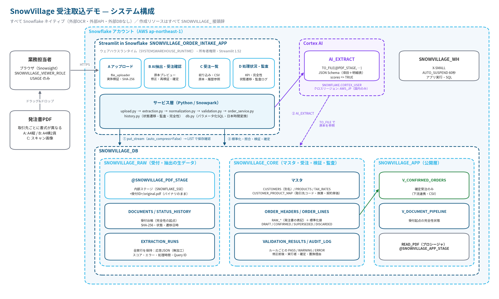

# SnowVillage デモ: 異なる書式のPDF発注書を Snowflake で受注データ化する

架空の事務用品卸「スノービレッジ文具販売」が、取引先ごとにレイアウトの違うPDF発注書を受け取り、
**アップロード → AI抽出 → 標準化 → 業務ルール検証 → 修正 → 受注確定 → 履歴・完全性の確認**までを
Snowflake のネイティブ機能だけで行うデモです（外部OCR・外部API・外部DBは不使用）。

> すべての企業名・住所・取引は架空です。

---

## 1. デモの概要

| 伝えたいこと | デモでの見せ方 |
|---|---|
| 書式が違っても共通形式に変換できる | A（A4縦・標準）/ B（A4横・2ページ・「注文No.」「品番」「希望納期」・和暦・独自品番）/ C（スキャン画像PDF）を同じ受注テーブルへ |
| AI抽出だけでなく業務検証まで行う | 取引先・商品マスタ照合、単位換算、数量×単価、税率マスタによる税額、合計検算、重複検証 |
| 処理結果を後から追跡できる | 受付ID起点の状態遷移・抽出実行履歴（応答JSON無加工）・検証結果・修正前後の監査ログ・完全性ファネル |

## 2. システム構成図



処理の流れ: [docs/processing_flow.png](docs/processing_flow.png) ／ 状態遷移: [docs/status_flow.png](docs/status_flow.png)

```
 ブラウザ (Snowsight)
   │  Streamlit in Snowflake  SNOWVILLAGE_ORDER_INTAKE_APP（ウェアハウスランタイム / 所有者権限）
   │   ├ 画面A アップロード ── st.file_uploader → PDF実体検証 → SHA-256 → 重複判定
   │   │                         └ session.file.put_stream(auto_compress=False) → LIST で保存確認
   │   ├ 画面B AI抽出・確認 ── AI_EXTRACT(TO_FILE(@PDF_STAGE, <受付ID>/original.pdf), JSON Schema, scores=>TRUE)
   │   │                         → normalization.py（標準化・マスタ照合）→ validation.py（業務ルール）
   │   │                         → 修正（監査ログ）→ 再検証 → 受注確定（確定直前に再検証）
   │   ├ 画面C 受注一覧 ─────── 確定受注ビュー / CSV / 受付IDから原本・履歴
   │   └ 画面D 処理状況・監査 ─ KPI / 完全性ファネル / 未完了検出 / 状態遷移 / 監査ログ
   ▼
 SNOWVILLAGE_DB
   ├ SNOWVILLAGE_RAW   DOCUMENTS / DOCUMENT_STATUS_HISTORY / EXTRACTION_RUNS / @SNOWVILLAGE_PDF_STAGE (SSE)
   ├ SNOWVILLAGE_CORE  CUSTOMERS / PRODUCTS / CUSTOMER_PRODUCT_MAP / TAX_RATES
   │                   ORDER_HEADERS / ORDER_LINES / VALIDATION_RESULTS / AUDIT_LOG
   └ SNOWVILLAGE_APP   V_CONFIRMED_ORDERS / V_DOCUMENT_PIPELINE / READ_PDF(proc) / @SNOWVILLAGE_APP_STAGE / Streamlit
```

詳細は [docs/architecture.md](docs/architecture.md)。

## 3. 作成する Snowflake オブジェクト

| 種別 | 名称 | 備考 |
|---|---|---|
| ロール | `SNOWVILLAGE_APP_OWNER_ROLE` | 全オブジェクト所有・`SNOWFLAKE.CORTEX_USER`。SYSADMIN の配下 |
| ロール | `SNOWVILLAGE_VIEWER_ROLE` | DB/APPスキーマ/Streamlit の USAGE のみ |
| ウェアハウス | `SNOWVILLAGE_WH` | X-SMALL, AUTO_SUSPEND=60秒, AUTO_RESUME, 初期停止 |
| データベース | `SNOWVILLAGE_DB` | |
| スキーマ | `SNOWVILLAGE_RAW` / `SNOWVILLAGE_CORE` / `SNOWVILLAGE_APP` | |
| ステージ | `SNOWVILLAGE_RAW.SNOWVILLAGE_PDF_STAGE` | SNOWFLAKE_SSE, DIRECTORY 有効（AI_EXTRACT 要件） |
| ステージ | `SNOWVILLAGE_APP.SNOWVILLAGE_APP_STAGE` | アプリコード |
| テーブル | RAW: `SNOWVILLAGE_DOCUMENTS`, `SNOWVILLAGE_DOCUMENT_STATUS_HISTORY`, `SNOWVILLAGE_EXTRACTION_RUNS` | |
| テーブル | CORE: `SNOWVILLAGE_CUSTOMERS`, `SNOWVILLAGE_PRODUCTS`, `SNOWVILLAGE_CUSTOMER_PRODUCT_MAP`, `SNOWVILLAGE_TAX_RATES`, `SNOWVILLAGE_ORDER_HEADERS`, `SNOWVILLAGE_ORDER_LINES`, `SNOWVILLAGE_VALIDATION_RESULTS`, `SNOWVILLAGE_AUDIT_LOG` | |
| ビュー | `SNOWVILLAGE_APP.SNOWVILLAGE_V_CONFIRMED_ORDERS`, `SNOWVILLAGE_APP.SNOWVILLAGE_V_DOCUMENT_PIPELINE` | |
| プロシージャ | `SNOWVILLAGE_APP.SNOWVILLAGE_READ_PDF(VARCHAR)` | 受付IDの原本をBase64で返す（ダウンロードの代替経路） |
| Streamlit | `SNOWVILLAGE_APP.SNOWVILLAGE_ORDER_INTAKE_APP` | `SYSTEM$WAREHOUSE_RUNTIME` |

すべて `IF NOT EXISTS` で作成し、既存オブジェクトを `CREATE OR REPLACE` しません。

## 4. 必要な権限・前提条件

- セットアップ実行者: `USERADMIN`（ロール作成）、`SYSADMIN`（WH/DB作成）、`ACCOUNTADMIN`（`SNOWFLAKE.CORTEX_USER` の付与）
- AI_EXTRACT が利用可能なリージョン。本環境（AWS ap-northeast-1）では利用可能を確認済み。
  アカウントパラメータ `CORTEX_ENABLED_CROSS_REGION` は既に `AWS_JP`（国内のみ）で、**本デモでは変更していません**。
- Snowflake CLI 3.x（`snow`）。ローカルテストには Python 3.11+ と `snowflake-snowpark-python`, `pytest`, `pypdfium2`, `streamlit==1.52.2`。
- サンプルPDF再生成には `reportlab`, `PyMuPDF`, `Pillow`（生成スクリプトのみ。アプリには不要）

## 5. セットアップ方法

```bash
snow sql -f sql/01_setup.sql          # ロール・WH・DB・スキーマ・ステージ
snow sql -f sql/03_tables.sql         # テーブル・ビュー（マスタ表もここで作成）
snow sql -f sql/02_master_data.sql    # マスタ投入（MERGE・冪等）
snow sql -f sql/05_procedures.sql     # 原本取得プロシージャ
snow sql -f sql/04_grants.sql         # 権限（Streamlit への GRANT はデプロイ後に再実行）
```

## 6. Streamlit のデプロイ手順

```bash
cd app   # app/ がデプロイのルート（app/snowflake.yml）
snow streamlit deploy --replace --role SNOWVILLAGE_APP_OWNER_ROLE --warehouse SNOWVILLAGE_WH --database SNOWVILLAGE_DB
snow sql -q "GRANT USAGE ON STREAMLIT SNOWVILLAGE_DB.SNOWVILLAGE_APP.SNOWVILLAGE_ORDER_INTAKE_APP TO ROLE SNOWVILLAGE_VIEWER_ROLE" --role SNOWVILLAGE_APP_OWNER_ROLE
```

- `app/snowflake.yml` で `runtime_name: SYSTEM$WAREHOUSE_RUNTIME` を明示。
  ウェアハウスランタイムはアプリのルートにある `streamlit_app.py` を起動するため（`main_file: app/streamlit_app.py` は
  `/tmp/appRoot/streamlit_app.py` が見つからないエラーになる）、`app/` をデプロイのルートにしています。Compute Pool は不要（追加費用なし）。
- パッケージは `environment.yml`（Snowflake Anaconda チャネル）: `streamlit=1.52.2`, `pandas`, `pypdfium2`, `snowflake-snowpark-python`。
  `environment.yml` もアプリのルート（`app/environment.yml`）に置きます。
- URL: `https://app.snowflake.com/<organization>/<account>/#/streamlit-apps/SNOWVILLAGE_DB.SNOWVILLAGE_APP.SNOWVILLAGE_ORDER_INTAKE_APP`
- 利用者には `GRANT ROLE SNOWVILLAGE_VIEWER_ROLE TO USER <user>;`（SECURITYADMIN）。

## 7. デモ操作方法

[docs/demo_scenario.md](docs/demo_scenario.md)（15分の進行台本）を参照。リハーサル後は
`sql/98_reset_demo_data.sql` で業務データ行とPDFステージだけを初期化できます（オブジェクト・マスタは残る）。

## 8. テスト実行方法

```bash
python -m venv .venv && . .venv/bin/activate
pip install "snowflake-snowpark-python[pandas]" pytest pypdfium2 "streamlit==1.52.2"

# 決定論的テスト（Snowflake/AI 非依存・記録済みAI応答を入力に使用）
pytest tests/test_normalization.py tests/test_validation.py -q

# End-to-End（実 Snowflake・実 AI_EXTRACT。接続名は SNOWVILLAGE_CONNECTION、既定 default）
pytest tests/test_order_workflow.py -v -s          # 終了時にテストで作成した受付分のみ削除
KEEP_TEST_DATA=1 pytest tests/test_order_workflow.py   # データを残す（画面確認用）

# 画面スモークテスト（Streamlit AppTest で全画面・全ステータスを描画）
cd app && python ../tests/ui_smoke.py
```

E2E テストは `samples/` のPDFが未受付であることを前提にします（受付済みなら `98_reset_demo_data.sql` 後に実行）。
AI抽出精度テスト（`test_ai_extraction_accuracy`）は業務ロジックのテストと分離しています。結果は [docs/test_results.md](docs/test_results.md)。

## 9. 利用した AI 関数・設定

- **AI_EXTRACT**（第一選択）: `AI_EXTRACT(file => TO_FILE('@...SNOWVILLAGE_PDF_STAGE', <path>), responseFormat => <JSON Schema>, scores => TRUE)`
  - ヘッダー10項目は `type: string`、明細は `type: object` + `column_ordering` + 列ごとの `type: array`（公式のテーブル抽出形式）
  - 列の配列長が一致しない場合は補完せず `LINE_STRUCTURE` ERROR
  - description で「記載がなければ空」と指示し、推測を求めない。空・「なし」等は NULL
  - 応答 JSON は `EXTRACTION_RUNS.RAW_RESPONSE` に無加工で保存。スコアは `SCORES` に保存し、0.70 未満は WARNING（参考値のみ。表スコアは表全体の集約値）
- **AI_PARSE_DOCUMENT**: 今回のサンプル（画像PDFを含む）は AI_EXTRACT 単独で全項目を抽出できたため**未使用**。
- PDF から得た文字列はデータとしてのみ扱い、SQL はすべてバインド変数で実行（命令として解釈しない）。

### 計算ルール（validation.py / normalization.py）

| 項目 | ルール |
|---|---|
| 明細金額 | `floor(数量 × 単価)`（円未満切り捨て）と記載金額が一致しなければ ERROR。金額未記載は計算値を示して WARNING |
| 税抜合計 | 明細金額の合計と記載値が不一致なら ERROR。記載なしは WARNING |
| 消費税 | 商品の税区分 → `TAX_RATES`（発注日時点で有効な税率）で、**税率ごとに合計して1回切り捨て**。差1円以内は端数処理差として WARNING、それ以上は ERROR、記載なしは WARNING |
| 税込合計 | 税抜合計（記載、なければ計算）＋消費税（同）と不一致なら ERROR |
| 単位換算 | `CUSTOMER_PRODUCT_MAP.UNIT_CONVERSION_FACTOR`（例: 青葉の「箱」= コピー用紙5冊）で標準数量を算出 |
| 単価照合 | 契約単価（あれば）→ 参考単価×換算係数と比較。違いは WARNING で**発注書の値を保持**（マスタで上書きしない）。単価未記載は WARNING |
| 取引先照合 | NFKC正規化・「株式会社/(株)/御中」等を除去して正式名称・別名と照合。無効取引先は ERROR |
| 重複 | 同一SHA-256は受付時に DUPLICATE（受注は作らない）。同一取引先・同一発注番号が別受付で確定済みなら ERROR（上書きしない）、下書きなら WARNING |
| 訂正版 | ERROR が発注番号重複だけの場合、「訂正版として確定」で理由（必須）と確認チェックを付けて置き換え可能。元の確定受注は SUPERSEDED（削除しない）、元の受付は状態 SUPERSEDED、訂正版ヘッダーに `CORRECTION_OF_ORDER_ID`・`CORRECTION_REASON`、差分と理由を監査ログに記録。置換と確定は1文のUPDATEで同時に反映 |

### 状態

`RECEIVING`（受付記録作成・保存確認前の一時状態）→ `UPLOADED` → `EXTRACTING` → `NEEDS_REVIEW` / `READY` → `CONFIRMED`、
失敗時 `FAILED`（再処理可能）、重複 `DUPLICATE`、訂正版で置き換えられた受付 `SUPERSEDED`。遷移はすべて `DOCUMENT_STATUS_HISTORY` に記録。
`RECEIVING` は「ステージ保存を確認してから受付成功を記録する」ために追加した状態です。

## 10. 費用に関する注意事項

- ウェアハウス: X-SMALL・60秒で自動停止。Streamlit はウェアハウスランタイムのため、**アプリを開いている間はウェアハウスが稼働**します。デモ後はタブを閉じてください。
- AI_EXTRACT: ページ数に応じた Cortex AI のクレジットを消費します（本サンプルは1件約5秒・1〜2ページ）。
  実績は管理者が `SNOWFLAKE.ACCOUNT_USAGE.CORTEX_FUNCTIONS_QUERY_USAGE_HISTORY` で、画面に表示される Query ID と突き合わせて確認できます。
  `scores => TRUE` に追加費用はありません。
- コンテナランタイム（Compute Pool）は使用していません。

## 11. リソースの削除方法

`sql/99_cleanup.sql` を開き、STEP 1 の確認クエリで削除対象が `SNOWVILLAGE_` 専用リソースだけであることを確認してから、
STEP 2 のコメントを外して実行してください。セットアップ・テストから自動では実行されません。

## ファイル構成

```
sql/01_setup.sql 02_master_data.sql 03_tables.sql 04_grants.sql 05_procedures.sql 98_reset_demo_data.sql 99_cleanup.sql
app/snowflake.yml app/environment.yml デプロイ定義（ウェアハウスランタイム・app/ がルート）
app/streamlit_app.py                  エントリ（st.navigation）
app/app_pages/*.py                    画面A〜D
app/upload.py extraction.py normalization.py validation.py order_service.py history.py db.py ui_common.py
samples/*.pdf expected_results.json   サンプル発注書と期待値（PDF生成元データ）
scripts/generate_sample_pdfs.py       サンプル生成
scripts/generate_diagrams.py          構成図・処理フロー図・状態遷移図（docs/*.png）の生成
tests/                                pytest（決定論 / E2E / AI精度）・ui_smoke.py・fixtures
docs/architecture.md demo_scenario.md test_results.md
```
