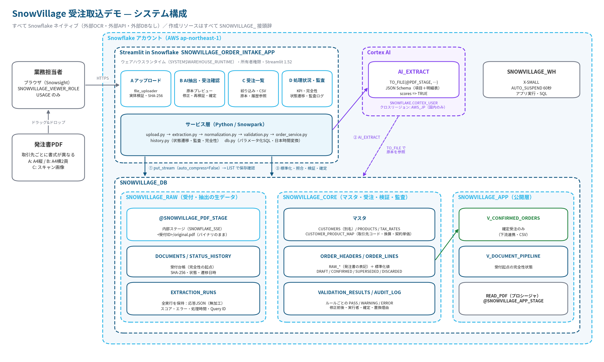
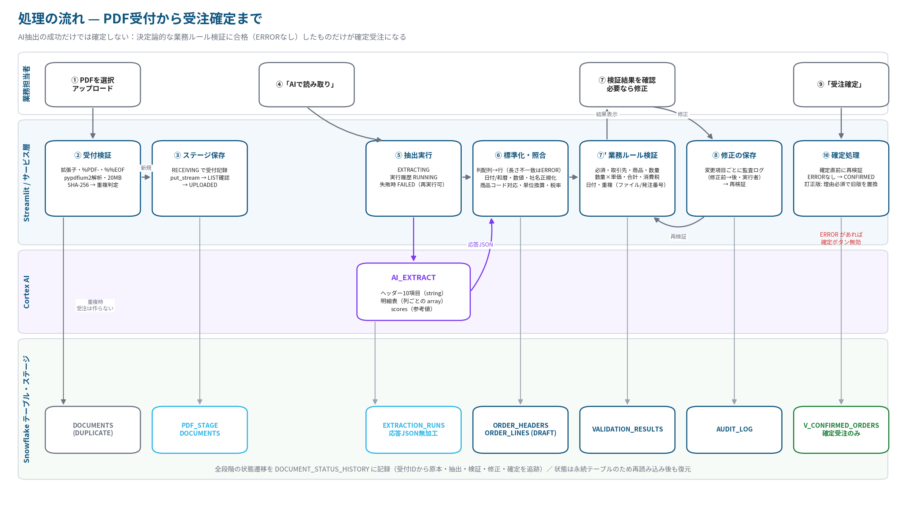
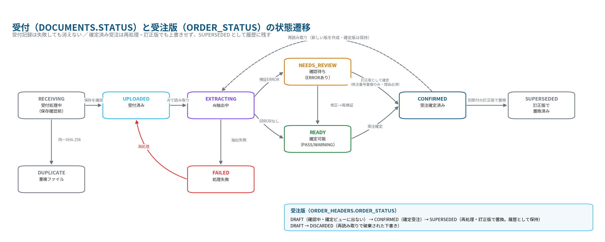

# アーキテクチャ







図は `python3 scripts/generate_diagrams.py` で再生成できます（matplotlib・Noto Sans CJK JP）。

## 設計方針

このデモの価値は「PDFをAIで読める」ことではなく、**取引先ごとに異なる発注書を業務で使える共通の受注データに変換し、
その正しさと完全性を確認できること**です。そのため次を原則としています。

1. **AIの出力は「候補」**。AI_EXTRACT の成功やスコアだけで受注を確定しない。確定は決定論的な業務ルール検証に合格した場合のみ。
2. **原文（RAW）と標準化値を分離**。`ORDER_HEADERS.RAW_*` / `ORDER_LINES.RAW_*` に抽出文字列を保持し、
   標準化値（DATE/NUMBER）と常に対応付けられる。抽出応答JSONは `EXTRACTION_RUNS.RAW_RESPONSE` に無加工で保存。
3. **マスタで発注書を書き換えない**。マスタ単価・換算係数・税率は別列（`MASTER_UNIT_PRICE` など）に保持し、差異は検証で指摘。
4. **受付記録が起点**。受付ID（UUID）を最初に発行して記録し、以後の全処理結果を受付IDにぶら下げる。途中で失敗しても受付記録は残る。
5. **状態はSnowflakeに永続化**。Streamlit のセッション状態は「どの受付を選択中か」程度に限定し、再読み込み・別セッションでも復元できる。

## 処理フロー

```
[アップロード]
  inspect_pdf: 拡張子 / %PDF- ヘッダー / %%EOF / pypdfium2 で解析・ページ数 / 20MB 上限
  SHA-256 → 同一ハッシュの保存済み受付あり → DUPLICATE として記録（保存・受注作成なし）→ 既存受付へ誘導
  DOCUMENTS INSERT (RECEIVING) → put_stream(@PDF_STAGE/<uuid>/original.pdf, auto_compress=False, overwrite=False)
  → LIST でパスとサイズを確認 → STAGE_VERIFIED=TRUE, UPLOADED
     （put 失敗・確認失敗は FAILED + LAST_ERROR。受付成功とは表示しない）

[AI抽出]  extraction.run_extraction
  EXTRACTION_RUNS INSERT (RUNNING, RESPONSE_FORMAT) → DOCUMENTS: EXTRACTING
  AI_EXTRACT(file => TO_FILE(...), responseFormat => PARSE_JSON(?), scores => TRUE)
  成功: RAW_RESPONSE / SCORES / QUERY_ID / ELAPSED_MS を保存
  失敗（例外 or 応答の error 非NULL）: FAILED + ERROR_MESSAGE、DOCUMENTS: FAILED（再実行で RUN_NO が増える）

[標準化]  normalization.normalize_order（純粋関数）
  列配列 → 行（長さ不一致は ERROR として報告、補完しない）
  日付: 2026年11月5日 / 2026/11/06 / 2026.11.07 / R8.11.20 / 令和8年… / 「必着」等の付記を無視。年なしは推測しない
  数値: NFKC、¥・円・カンマ・末尾「-」除去、△▲は負数
  取引先: 法人格・敬称を除去して正式名称・別名と照合
  商品: 取引先別対応表 → 自社コード一致 → 未対応（手動対応付けは MANUAL として記録）
  税: 商品の税区分 → TAX_RATES（発注日に有効な税率）

[下書き作成]  order_service.create_draft（トランザクション）
  同一受付の旧 DRAFT は DISCARDED、新しい VERSION_NO で ORDER_HEADERS / ORDER_LINES を挿入
  確定済み (CONFIRMED) の版には触れない

[検証]  validation.validate（純粋関数）→ VALIDATION_RESULTS に全ルールの結果を保存
  ERROR あり → NEEDS_REVIEW / なし → READY

[修正]  order_service.save_edits
  変更項目ごとに AUDIT_LOG（項目名・修正前・修正後・実行者・日時）、IS_EDITED=TRUE、検証結果を無効化（要再検証）

[訂正版として確定]  order_service.confirm_correction
  再検証 → ERROR が DUPLICATE_ORDER_NUMBER だけの場合のみ / 理由必須 / 画面表示時の置換対象と一致することを確認
  1文の UPDATE で 元の確定受注 → SUPERSEDED（SUPERSEDED_BY）・訂正版 → CONFIRMED（CORRECTION_OF_ORDER_ID, CORRECTION_REASON）
  元の受付の状態 → SUPERSEDED、差分・理由を AUDIT_LOG（SUPERSEDE_BY_CORRECTION / CONFIRM_CORRECTION）、置換後に再検証

[確定]  order_service.confirm_order
  確定直前に必ず再検証 → ERROR なら CONFIRM_BLOCKED を記録して拒否
  同一受付の旧 CONFIRMED は SUPERSEDED（差分を AUDIT_LOG に保存）→ 新版を CONFIRMED
```

## データの見え方（部分データを確定扱いしない）

| ORDER_STATUS | 意味 | 確定受注ビュー |
|---|---|---|
| DRAFT | 抽出・確認中 | 含まない |
| CONFIRMED | 確定受注 | **含む** |
| SUPERSEDED | 再処理で置き換えられた旧確定版 | 含まない（履歴として保持） |
| DISCARDED | 再抽出で破棄された下書き | 含まない |

下流システム連携は `SNOWVILLAGE_APP.SNOWVILLAGE_V_CONFIRMED_ORDERS` のみを参照する想定です。

## 完全性管理

`SNOWVILLAGE_V_DOCUMENT_PIPELINE` が受付記録を起点に抽出実行・最新受注・確定受注を左結合し、
受付ごとの `COMPLETENESS_STATE`（保存未確認 / 未抽出 / 抽出失敗 / 処理失敗 / 未検証 / 確認待ち / 確定待ち / 確定済 / 重複）を返します。
画面D は「受付 → 保存成功 → 抽出実行 → 抽出成功 → 検証合格 → 確定」のファネルと、未完了の受付一覧を表示します。
オプションでステージの `LIST` 結果と突き合わせ、「受付記録上は保存済みだが原本が存在しない」状態も検出します。
対象はアプリで受付を試みたPDFに限られます（アプリ外の発注書は検出できません）。

## ランタイムと権限

- Streamlit in Snowflake・**ウェアハウスランタイム**（`SYSTEM$WAREHOUSE_RUNTIME`）。所有者権限で実行。
- 利用者ロール `SNOWVILLAGE_VIEWER_ROLE` は DB / APP スキーマ / Streamlit の USAGE のみ。テーブル・ステージ・WHへの直接権限なし。
- 操作者の識別は `st.user`（取得できない場合は `CURRENT_USER()`）を監査ログ・状態遷移・確定者に記録。
- 所有者権限のサーバー側 Python 環境で `put_stream` / `LIST` / `get_stream` / `pypdfium2` が動作することを事前に確認済み
  （匿名プロシージャで検証。Snowsight 上での実画面操作は未検証 → test_results.md 参照）。
- `get_stream` が失敗した場合は `SNOWVILLAGE_READ_PDF`（EXECUTE AS OWNER・受付ID(UUID)のみ受け付け）で原本を取得。

## モジュール

| ファイル | 役割 | Snowflake 依存 |
|---|---|---|
| `db.py` | セッション取得、パラメータ化クエリ、INSERT ヘルパー、トランザクション | あり |
| `upload.py` | PDF実体検証、ハッシュ、重複判定、put_stream、保存確認、原本取得 | あり |
| `extraction.py` | AI_EXTRACT スキーマ定義・実行・履歴 | あり |
| `normalization.py` | 標準化・マスタ照合・税計算 | **なし（純粋関数）** |
| `validation.py` | 業務ルール検証 | **なし（純粋関数）** |
| `order_service.py` | 下書き・修正・検証・確定・再処理のオーケストレーション | あり |
| `history.py` | 状態遷移・監査ログ・完全性集計 | あり |
| `ui_common.py`, `app_pages/*` | Streamlit 画面 | あり |
